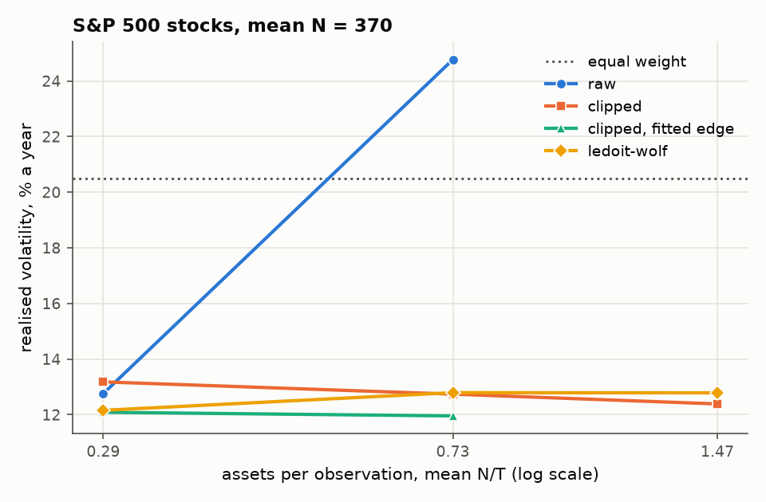
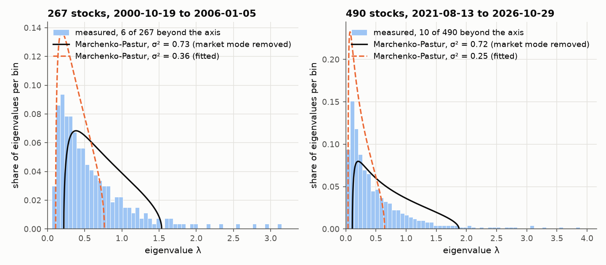
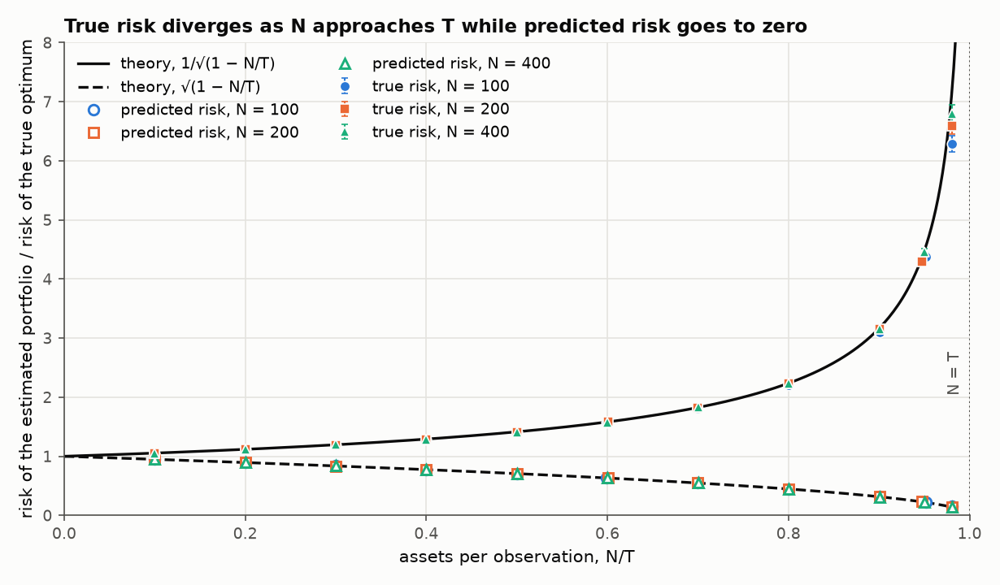
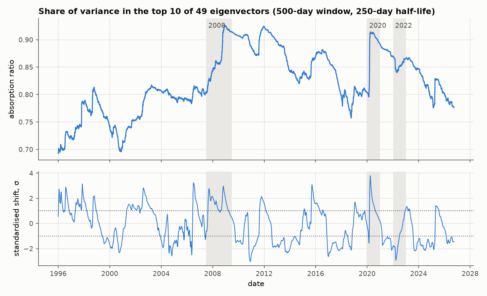
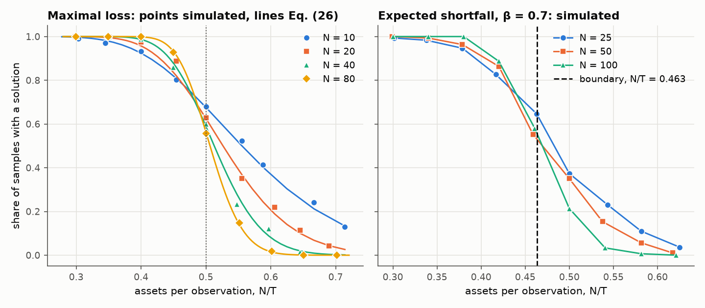

# Static

[](https://github.com/mal0ware/static/actions/workflows/ci.yml)

How much of a measured correlation matrix is noise, what does the noise cost a portfolio optimizer, and does cleaning the matrix help?

## Result

For S&P 500 stocks, 71 to 77% of the eigenvalues of the correlation matrix fall inside a Marchenko-Pastur noise band once the market mode is removed. Laloux et al. reported 94% for 1991 to 1996. The 5 to 8% of eigenvalues above the band carry 53 to 68% of the variance, and the top one alone carries 27 to 45%.

The noise is expensive when the matrix is inverted. A minimum-variance portfolio of about 370 stocks estimated on two years of days (N/T = 0.73) had a realised volatility of 24.8% a year out of sample, against 20.5% for equal weights. Cleaning the same matrix first gave 12.7% with eigenvalue clipping and 12.8% with Ledoit-Wolf shrinkage. The two cannot be told apart at one and two years of history. At five years clipping is worse than shrinkage by 8% (95% interval 3 to 15%) and worse than the uncleaned matrix.



In simulation the cost follows theory. The true risk of the estimated portfolio over the best possible one grows as 1/√(1 − N/T). The simulated mean is within 1.3% of that curve for N/T up to 0.8, 0.8 to 2.3% low at 0.9, and 5 to 12% low at 0.98. An exact finite-size law accounts for the shortfall: all 33 simulated means are within 2.3 standard errors of it.

The main limit is survivorship. The stock panel holds only index members whose prices could still be downloaded in 2026: 53% of members in 2005, 65% in 2010, 87% in 2020. Stocks that were delisted or absorbed are mostly missing, so the volatility levels are too low. The comparison between estimators uses the same stocks on the same days for each method.

## Reproduce

```
uv sync
uv run python scripts/fetch_data.py
uv run python scripts/reproduce.py
```

The full run takes 15 to 20 minutes and rewrites everything in `results/`. `--fast` runs smaller simulations in about a minute and writes to `results_fast/`. All tables are in `results/summary.md`.

## What it found

### Stock spectra

`results/table13_stock_spectra.csv` repeats the measurement of Laloux et al. on five back-to-back windows of 1309 days, their window length, from 2000 to 2026. Each window uses the stocks that were index members on its last day and traded on every day in it: 267 stocks in the first window, 490 in the last.

| Window | Stocks | Top eigenvalue, share of variance | Eigenvalues in the band | Below the band | Above the band | Variance above the band |
| --- | --- | --- | --- | --- | --- | --- |
| 2000-10 to 2006-01 | 267 | 27% | 72% | 20% | 21 | 53% |
| 2006-01 to 2011-03 | 316 | 45% | 72% | 21% | 22 | 65% |
| 2011-03 to 2016-06 | 368 | 42% | 77% | 17% | 23 | 62% |
| 2016-06 to 2021-08 | 440 | 41% | 71% | 23% | 27 | 68% |
| 2021-08 to 2026-10 | 490 | 28% | 76% | 19% | 27 | 59% |

The band is the one Laloux et al. start from, with noise variance 1 − λ₁/N. About a fifth of the eigenvalues sit below it, which pure noise would not produce. Moving the band does not rescue the 94%: the best any Marchenko-Pastur band does on these spectra is 74 to 80% (a scan added after seeing the table).



Portfolios are further from noise than stocks. For 100 size and book-to-market portfolios in 1991 to 1996 the top eigenvalue holds 54% of the variance, and no band holds more than 72% of the eigenvalues (`results/table4_real_spectra.csv`, `results/fig3_mp_real.png`).

### Minimum-variance portfolios of stocks

`results/table14_stock_min_variance.csv`. Every 21 days from January 2005 to October 2026 (261 rebalances) the covariance of the trailing window is estimated, the fully invested minimum-variance portfolio is formed with shorting allowed, and it is held for 21 days. The stocks at each rebalance are the index members that day with five years of unbroken history, between 253 and 490 of them.

| History | N/T | Equal weight | Raw | Clipped | Ledoit-Wolf | Clipped over Ledoit-Wolf |
| --- | --- | --- | --- | --- | --- | --- |
| 252 days | 1.47 | 20.5% | not invertible | 12.4% | 12.8% | 0.97 (0.92 to 1.01) |
| 504 days | 0.73 | 20.5% | 24.8% | 12.7% | 12.8% | 1.00 (0.93 to 1.07) |
| 1260 days | 0.29 | 20.5% | 12.8% | 13.2% | 12.2% | 1.08 (1.03 to 1.15) |

Figures are realised volatility a year. The last column is the ratio of realised volatilities with a 95% block-bootstrap interval over holding periods.

Clipping keeps 6 to 12 eigenvalues of about 370. With five years of data the matrix can support more structure than that, and clipping throws it away. A variant that fits the noise edge to the spectrum keeps 73 to 102 eigenvalues and gives 12.0% and 12.1% at two and five years. It was added after looking at portfolio spectra, so its showing is not a clean test.

Every estimator understates its own risk. Realised volatility is 1.7 to 3.1 times predicted for the cleaned matrices and 6.9 times for the raw one at N/T = 0.73.

### Minimum-variance portfolios of portfolios

The same test on 49 industry portfolios and on 100 size and book-to-market portfolios, 627 rebalances from 1974 to 2026 (`results/table6_clipping_real.csv`). Clipping helps only when the window is short. For 49 industries and 63 days of history it gives 11.8% against 19.3% raw. With a year or more it is worse than raw by 0.5 to 1.2 points in both sets. Ledoit-Wolf is at or below clipping in all ten rows, by 4 to 18%, and the interval excludes a tie in nine of them.


### Out-of-sample risk against N/T in simulation



`results/table1_divergence.csv` has 33 combinations of N = 100, 200, 400 and N/T from 0.1 to 0.98, with 2000, 1000 and 500 samples. The ratio of the simulated mean to 1/√(1 − N/T) is 0.990 to 1.000 for N/T up to 0.7, 0.987 to 0.999 at 0.8, 0.977 to 0.992 at 0.9, 0.956 to 0.996 at 0.95, and 0.881, 0.924 and 0.952 at 0.98.

The formula is a limit for large N. At finite size the squared ratio is 1 + (N − 1)/(T − N + 2) times an F variable with N − 1 and T − N + 2 degrees of freedom, whatever the true covariance. With T − N = 2 that distribution has a heavy tail and no finite variance for the square, so the table reports the median too. At N/T = 0.98:

| N | Median, simulated (95% interval) | Median, exact | Mean, simulated | Mean, exact | Limit |
| --- | --- | --- | --- | --- | --- |
| 100 | 5.49 (5.38 to 5.60) | 5.50 | 6.29 | 6.31 | 7.14 |
| 200 | 6.08 (5.97 to 6.20) | 6.17 | 6.60 | 6.70 | 7.14 |
| 400 | 6.54 (6.37 to 6.71) | 6.61 | 6.80 | 6.92 | 7.14 |

The median rises towards the limit as N grows, and the three intervals do not overlap. The root mean square is 7.0 at all three sizes against an exact 7.1.

The optimizer's own estimate of its risk goes the other way, as √(1 − N/T). With 100 assets and 111 days the portfolio is 3.1 times riskier than the optimum and reports 0.32 times the optimum's risk. A re-run of Pafka and Kondor's Table 1 matches every printed value to within 0.015.

When the truth is one market factor plus noise, clipping holds the ratio between 1.03 and 1.11 up to N/T = 0.98, where the raw estimate averages 6.8. Ledoit-Wolf holds it between 1.05 and 1.21. All three are scored on the same 200 samples per row (`results/table5_clipping_sim.csv`). This model is the best case for clipping, because the truth is exactly what clipping assumes.

Pure-noise spectra follow the Marchenko-Pastur density. At T/N = 3.22 the Kolmogorov distance falls from 0.067 at N = 25 to 0.004 at N = 800 (`results/fig2_mp_simulated.png`).

### Absorption ratio

Share of variance in the top 10 of 49 industry eigenvectors, 500-day window, as in Kritzman et al.

| Episode | Ratio at start | Peak | Peak date | Market drawdown |
| --- | --- | --- | --- | --- |
| 2008 | 0.804 | 0.927 | 2008-12-02 | 54.6% |
| 2020 | 0.804 | 0.914 | 2020-04-09 | 34.2% |
| 2022 | 0.870 | 0.870 | 2022-01-05 | 25.4% |



The 2008 peak is the highest since the series starts in 1971. In 2022 the ratio drifted down all year while the market fell.

Kritzman et al. report that stocks did worse after the ratio spiked. On their dates (1998 to May 2010) the sign agrees: returns over the next week were −6.1% annualised after a one-sigma increase and 8.4% after a decrease. The gap of −14.5 points has a 95% block-bootstrap interval of −42 to 15, so it cannot be told from zero. The signal days fall in only 7 runs of increases and 8 of decreases. From May 2010 to September 2026 the sign reverses: 35.1% after increases and 10.0% after decreases, a gap of 25 points with an interval of 4 to 47, again from 8 and 9 runs.

### Maximal loss and expected shortfall

Minimising the worst loss in the sample has no solution in some samples, because the loss can be driven down without limit by going long and short. Kondor, Pafka and Nagy give the exact probability. Simulation with 400 samples a cell is within two standard errors in 32 of 36 cells and within 2.3 in three more. The last, N = 20 and T = 44, is 3.5 away. `reproduce.py` re-runs any cell that far out with 4,000 fresh samples: it comes back at 0.816 against 0.820, 0.6 standard errors low (`results/table16_ml_recheck.csv`). Their normal approximation is too low at small sizes (0.50 against 0.68 at N = 10, T = 20).

For expected shortfall at the 70% level, the equations of Ciliberti, Kondor and Mézard put the boundary at N/T = 0.463. The simulated share of solvable samples crosses one half at 0.483, 0.470 and 0.469 for N = 25, 50 and 100.



## Comparison with the sources

| Claim | Source | Here |
| --- | --- | --- |
| Noise spectra follow the Marchenko-Pastur density | Laloux et al. Eq. (3) | Holds |
| 94% of a stock spectrum fits the noise density | Laloux et al., 406 stocks, 1991 to 1996 | 71 to 77% on S&P 500 members, 2000 to 2026 |
| The eigenvalues above the band carry 26% of the variance | Laloux et al. | 53 to 68% |
| True risk grows as 1/√(1 − N/T) | Kondor et al. Eq. (7) | Holds as a limit; 5 to 12% low at N/T = 0.98, as the exact law predicts |
| Table 1 of risk ratios | Pafka and Kondor | q0, q1, q2 match to 0.015 |
| Clipping lowers realised risk | Potters et al. | Yes against the raw matrix at N/T of 0.7 and above. No better than Ledoit-Wolf on stocks, worse on portfolios |
| The absorption ratio rises in crises | Kritzman et al. | 2008 and 2020 yes, 2022 no |
| Stocks fall after the ratio spikes | Kritzman et al. Exhibit 9 | Same sign on their dates, not distinguishable from zero; reversed after |
| Probability that maximal loss has a solution | Kondor et al. Eq. (26) | Holds |
| Expected-shortfall phase boundary | Ciliberti et al. Eqs. (21), (22), (24) | Holds at the one level simulated |

`PAPER.md` gives each formula with its equation number, the copy that was read, and every number that differs from a source.

## Data

Stocks: daily log returns of 628 stocks and their daily S&P 500 membership from 2000 to October 2026, from G. Lim's Zenodo deposit [10.5281/zenodo.23933497](https://doi.org/10.5281/zenodo.23933497). The deposit licenses its processed data under CC BY 4.0 and built it from Yahoo Finance prices and a public history of index membership. `results/table15_stock_coverage.csv` is its own count of the members it recovered, by year: 47% of members in 2000, rising to 99% in 2026. No filter for bad prints or stale prices was applied here.

Portfolios: three files from the Kenneth R. French data library, daily returns on 49 industry portfolios and on 100 size and book-to-market portfolios, and the daily research factors for the market return. The files are copyright Eugene F. Fama and Kenneth R. French; read the library's terms before redistributing them.

`scripts/fetch_data.py` downloads both into `data/`, which is not committed. No key or account is needed. The Zenodo archive is 525 MB, and the script reads only the four files it needs (about 30 MB) with range requests. Stooq, the source first tried for stocks, now puts its downloads behind a browser check.

The committed results use the French files built from the 202609 CRSP database, ending 2026-09-30, and version 1.0.0 of the Zenodo deposit. `results/data_vintage.txt` records the file hashes. French revises history when the files are rebuilt, so a later download can change the portfolio tables in the second or third digit.

## Code

- `static.mp`: the Marchenko-Pastur density, its edges and distribution function, and a fit of the noise variance to the bulk of a spectrum.
- `static.cleaning`: sample correlation matrices and eigenvalue clipping.
- `static.shrinkage`: the Ledoit-Wolf estimator, written here from their Eq. (14).
- `static.portfolio`: minimum-variance weights, the three risk ratios of Pafka and Kondor, and the exact finite-size law of the true risk ratio.
- `static.absorption`: the absorption ratio with exponential weights, and its standardised shift.
- `static.feasibility`: the linear programmes for maximal loss and expected shortfall, the exact probability that the maximal-loss problem has a solution, and the expected-shortfall phase boundary.
- `static.remote`: reads single files out of a remote zip archive.
- `static.experiments`: the code behind each table.

## Tests

131 tests. CI runs them with the linter, the type checker and the `--fast` reproduce on every push.

- Eigenvalues of pure-noise matrices fall inside the Marchenko-Pastur bounds, and the density has the right first three moments
- A planted factor is recovered after cleaning, and clipping preserves the trace
- The Ledoit-Wolf code matches the formula written out observation by observation, and its shrinkage weight matches the oracle weight in simulation
- The finite-size law of the risk ratio passes a Kolmogorov-Smirnov test against simulation for identity and market-mode covariances
- The universe at each rebalance does not change when later data changes
- The absorption ratio matches closed forms for identity and one-factor matrices
- The maximal-loss probability matches the hand-worked two-asset case, a direct binomial sum and a simulation
- Every simulated table and every bootstrap interval is identical from run to run

```
uv run pytest
uv run ruff check
uv run mypy src
```

## Sources

- Marchenko and Pastur, "Distribution of eigenvalues for some sets of random matrices", Math. USSR-Sbornik 1(4), 1967
- Laloux, Cizeau, Bouchaud and Potters, "Noise Dressing of Financial Correlation Matrices", Physical Review Letters 83(7), 1999
- Pafka and Kondor, "Noisy covariance matrices and portfolio optimization II", Physica A 319, 2003
- Potters, Bouchaud and Laloux, "Financial Applications of Random Matrix Theory: Old Laces and New Pieces", Acta Physica Polonica B 36(9), 2005
- Ledoit and Wolf, "A well-conditioned estimator for large-dimensional covariance matrices", Journal of Multivariate Analysis 88(2), 2004
- Kondor, Pafka and Nagy, "Noise sensitivity of portfolio selection under various risk measures", Journal of Banking and Finance 31(5), 2007
- Ciliberti, Kondor and Mézard, "On the feasibility of portfolio optimization under expected shortfall", Quantitative Finance 7(4), 2007
- Kritzman, Li, Page and Rigobon, "Principal Components as a Measure of Systemic Risk", Journal of Portfolio Management 37(4), 2011

## Limits

- Survivorship in the stock panel, as described under Result. Before 2010 fewer than two thirds of index members are present, and the missing ones are the stocks that failed or were taken over. A holding that leaves the panel during the 21-day holding period is given a zero return from then on.
- The stocks are large US companies from 2000 on, taken from one free source. Laloux et al. used 1991 to 1996. The gap between their 94% and the 71 to 77% here could come from the period, the universe, the data, or the fact that they fitted the noise variance by eye.
- Ledoit-Wolf here means shrinkage towards a multiple of the identity. Their later targets (constant correlation, single factor) and nonlinear shrinkage were not run.
- No trading costs. The minimum-variance portfolios run gross leverage of 4 to 7 on stocks, and a 21-day rebalance would cost real money.
- The fitted-edge variant of clipping and the scan for the widest band were both added after seeing spectra. Neither is an out-of-sample result.
- The divergence formula and the exact law are for independent Gaussian returns with a known zero mean. On real returns the gap between predicted and realised risk was larger than either gives at every window length.
- The absorption ratio comparison uses 49 French industries where the paper uses 51 MSCI industries, and the 2010 working paper was read in place of the journal version. Each period has under ten separate runs of signal days, and the bootstrap block of 126 days was a choice.
- Expected-shortfall feasibility was simulated at one level, 70%, and the boundary curve was compared with the paper's figure by eye.
- The original Marchenko and Pastur paper was not read. The density is taken from Laloux et al. and from Pafka and Kondor.
- Cleaning helps risk estimates. It says nothing about expected returns.
- This is research code. It is not investment advice and it does not trade.

The name: static is what you hear between stations.

## Licence

MIT. See `LICENSE`.
