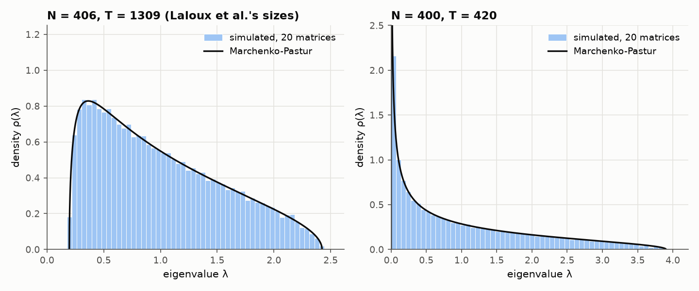
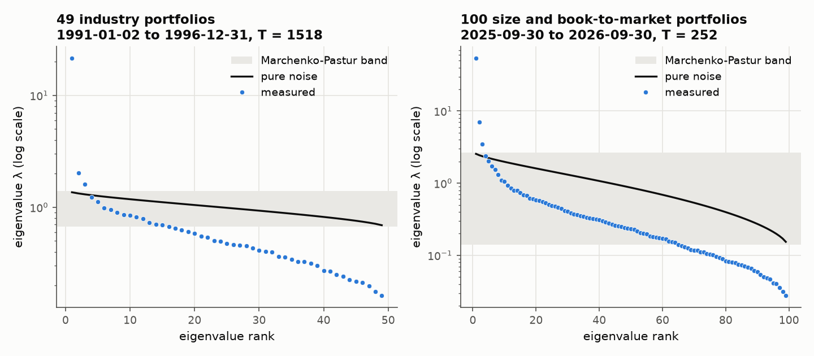
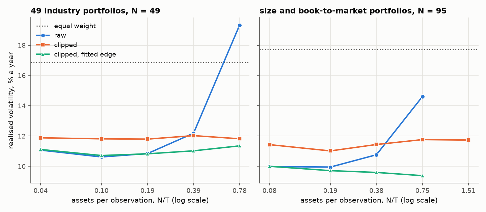

# Static

**Most of a correlation matrix is noise. Here is how to see which part.**

## Result

A minimum-variance portfolio built from a sample covariance matrix carries more risk than the best possible one by a factor of 1/√(1 − N/T), where N is the number of assets and T the number of observations. Simulation lands on that curve: within 1% for N/T up to 0.7 and within 4.1% at N/T = 0.9, for 100, 200 and 400 assets. The risk the optimizer reports for itself goes the other way, as √(1 − N/T). With 100 assets and 111 days the portfolio is 3.0 times riskier than the optimum and looks 0.32 times as risky.


On real data the picture is less tidy. Eigenvalue clipping fixes the divergence in simulation and helps on real portfolios only when N/T is large. The absorption ratio rose in 2008 and 2020 and did not rise in 2022.

## The question

With 100 stocks and a year of days, how many of the correlations you measured are real? And what happens to an optimizer that believes all of them?

## Reproduce

```
uv sync
uv run python scripts/fetch_data.py
uv run python scripts/reproduce.py
```

The full run takes about five minutes and rewrites everything in `results/`. `--fast` runs smaller simulations in under a minute and writes to `results_fast/`. All tables are in `results/summary.md`.

## What was built

- `static.mp`: the Marchenko-Pastur density, its edges and distribution function, and a fit of the noise variance to the bulk of a spectrum.
- `static.cleaning`: sample correlation matrices and eigenvalue clipping.
- `static.portfolio`: minimum-variance weights and the three risk ratios of Pafka and Kondor (true, predicted, realised).
- `static.absorption`: the absorption ratio with exponential weights, and its standardised shift.
- `static.feasibility`: the linear programmes for maximal loss and expected shortfall, the exact probability that the maximal-loss problem has a solution, and the expected-shortfall phase boundary.
- `static.experiments`: the code behind each table.

## What it found

### Out-of-sample risk against N/T

`results/table1_divergence.csv` has 33 combinations. Near the critical point the simulated mean falls below the formula: 6.4 to 6.6 against 7.1 at N/T = 0.98. The formula is a large-N limit and the gap shrinks as N grows. A re-run of Pafka and Kondor's Table 1 matches every printed q0, q1 and q2 to within 0.015.

### Marchenko-Pastur against simulated and real spectra

Pure-noise spectra follow the density. At T/N = 3.22 the Kolmogorov distance falls from 0.067 at N = 25 to 0.004 at N = 800.



Real portfolio correlations do not. For 100 size and book-to-market portfolios in 1991 to 1996 the top eigenvalue is 34 times the noise edge and holds 54% of the variance. Two more clear the edge. The other 97 fall away steadily and never settle into the noise band.



### Clipping

When the truth is one market factor plus noise, clipping holds the risk ratio between 1.03 and 1.11 all the way to N/T = 0.98, where the raw estimate reaches 7.0 (`results/fig5_clipping_sim.png`).

On real returns, with a monthly rebalance from 1974 to 2026, clipping at the standard edge helps only with short windows. For 49 industries and 63 days of history, realised volatility is 11.8% a year clipped against 19.3% raw. With a year or more of history the clipped portfolio is worse than the raw one by about a point. A second variant that fits the noise edge to the spectrum stays level with raw or better, but it was added after looking at the data.



Predicted risk is too low everywhere. Even with five years of data on 49 industries, realised volatility is 1.2 times what the raw estimate predicted.

### Absorption ratio

Share of variance in the top 10 of 49 eigenvectors, 500-day window, as in Kritzman et al.

| Episode | Ratio at start | Peak | Peak date | Market drawdown |
| --- | --- | --- | --- | --- |
| 2008 | 0.804 | 0.927 | 2008-12-02 | 54.6% |
| 2020 | 0.804 | 0.914 | 2020-04-09 | 34.2% |
| 2022 | 0.870 | 0.870 | 2022-01-05 | 25.4% |


The 2008 peak is the highest since the series starts in 1971. In 2022 the ratio drifted down all year while the market fell.

Kritzman et al. report that stocks did worse after the ratio spiked. On their dates (1998 to May 2010) the sign agrees: returns over the next week were −6.1% annualised after a one-sigma increase and 8.4% after a decrease, against their −8.4% and 10.1%. From May 2010 to September 2026 it reverses: 35.1% after increases, 10.0% after decreases.

### Maximal loss and expected shortfall

Minimising the worst loss in the sample has no solution in some samples, because the loss can be driven down without limit by going long and short. Kondor, Pafka and Nagy give the exact probability. Simulation agrees in 35 of 36 cells to within 2.3 standard errors; the other is a chance outlier that a larger separate run did not repeat. Their normal approximation is too low at small sizes (0.50 against 0.68 at N = 10, T = 20).

For expected shortfall at the 70% level, the equations of Ciliberti, Kondor and Mézard put the boundary at N/T = 0.463. The simulated share of solvable samples crosses one half at 0.483, 0.470 and 0.469 for N = 25, 50 and 100.


## Sources

- Marchenko and Pastur, "Distribution of eigenvalues for some sets of random matrices", Math. USSR-Sbornik 1(4), 1967
- Laloux, Cizeau, Bouchaud and Potters, "Noise Dressing of Financial Correlation Matrices", Physical Review Letters 83(7), 1999
- Kritzman, Li, Page and Rigobon, "Principal Components as a Measure of Systemic Risk", Journal of Portfolio Management 37(4), 2011
- Kondor, Pafka and Nagy, "Noise sensitivity of portfolio selection under various risk measures", Journal of Banking and Finance 31(5), 2007
- Ciliberti, Kondor and Mézard, "On the feasibility of portfolio optimization under expected shortfall", Quantitative Finance 7(4), 2007

Two more were needed for formulas the five above do not print:

- Pafka and Kondor, "Noisy covariance matrices and portfolio optimization II", Physica A 319, 2003
- Potters, Bouchaud and Laloux, "Financial Applications of Random Matrix Theory: Old Laces and New Pieces", Acta Physica Polonica B 36(9), 2005

`PAPER.md` gives each formula with its equation number, the copy that was read, and every number that differs from a source.

## Comparison with the sources, in brief

| Claim | Source | Here |
| --- | --- | --- |
| Noise spectra follow the Marchenko-Pastur density | Laloux et al. Eq. (3) | Holds |
| 94% of a real spectrum fits the noise density | Laloux et al., 406 stocks | Not reproduced; portfolios, not stocks |
| True risk grows as 1/√(1 − N/T) | Kondor et al. Eq. (7) | Holds; 7 to 11% low at N/T = 0.98 |
| Table 1 of risk ratios | Pafka and Kondor | q0, q1, q2 match to 0.015 |
| Clipping lowers realised risk | Potters et al. | Only at large N/T on real data |
| The absorption ratio rises in crises | Kritzman et al. | 2008 and 2020 yes, 2022 no |
| Stocks fall after the ratio spikes | Kritzman et al. Exhibit 9 | Same sign on their dates, reversed after |
| Probability that maximal loss has a solution | Kondor et al. Eq. (26) | Holds |
| Expected-shortfall phase boundary | Ciliberti et al. Eqs. (21), (22), (24) | Holds at the one level simulated |

## Data

Simulated matrices, and three files from the Kenneth R. French data library: daily returns on 49 industry portfolios and on 100 size and book-to-market portfolios, and the daily research factors for the market return. `scripts/fetch_data.py` downloads them into `data/`, which is not committed. No key or account is needed. The files are copyright Eugene F. Fama and Kenneth R. French; read the library's terms before redistributing them.

The committed results use the files built from the 202609 CRSP database, ending 2026-09-30. French revises history when the files are rebuilt, so a later download can change the real-data tables in the second or third digit. The simulated tables do not depend on the download.

## How it is tested

95 tests, with the maths checked before any result is trusted.

- Eigenvalues of pure-noise matrices fall inside the Marchenko-Pastur bounds, and the density has the right first three moments
- A planted factor is recovered after cleaning, and clipping preserves the trace
- The simulated divergence sits where the theory puts it, and the closed form matches a numerical integral of the density
- The absorption ratio matches closed forms for identity and one-factor matrices
- The maximal-loss probability matches the hand-worked two-asset case, a direct binomial sum and a simulation
- The expected-shortfall boundary tends to one half and its closed-form pieces match quadrature
- Every simulated table is identical from run to run

```
uv run pytest
uv run ruff check
uv run mypy src
```

## Layout

```
src/static/      the code
tests/             maths tests first
scripts/reproduce.py   one command rebuilds every figure and table
scripts/fetch_data.py  downloads public data into data/ (never committed)
results/           committed figures and small tables
PAPER.md           citations, claims tested, comparison with the sources
```

## Roadmap

- [x] Project skeleton, CI, and the reproduce command
- [x] The Marchenko-Pastur density against the eigenvalues of simulated and real correlation matrices
- [x] Eigenvalue clipping, and what it does to out-of-sample portfolio risk
- [x] The absorption ratio through 2008, 2020 and 2022
- [x] Out-of-sample risk as the ratio of assets to observations rises, diverging at the critical point
- [x] `PAPER.md` comparison with the sources
- [x] Results and limits written up at the top of this file

Not done: a test on individual stocks, which is what Laloux et al. used. No free source without a key was found.

## Limits

- The real data are portfolios. Each one is already an average over many stocks, so the noise that Laloux et al. found in single-stock correlations is mostly gone before the matrix is formed. Nothing here says how much of a stock-level correlation matrix is noise.
- The clipping result on real data depends on that. With 3 or 4 eigenvalues above the edge out of 49 or 95, clipping keeps very little. A universe of stocks could come out differently.
- The fitted-edge variant was added after seeing the spectra and was scored on the same returns. Its edge over standard clipping is not an out-of-sample result.
- The divergence formula is for independent Gaussian returns with a known zero mean. On real returns the gap between predicted and realised risk was larger than the formula gives at every window length.
- Near N/T = 1 the simulated mean of the risk ratio is 7 to 11% below the formula at the sizes run, and its spread is large (standard deviation 3.4 at N = 100).
- The absorption ratio comparison uses 49 French industries where the paper uses 51 MSCI industries, and the 2010 working paper was read in place of the journal version.
- The reversal of the absorption ratio signal after 2010 is one sample of sixteen years with clustered signal days. The t-statistics in the table overstate it.
- Expected-shortfall feasibility was simulated at one level, 70%, and the boundary curve was compared with the paper's figure by eye.
- The original Marchenko and Pastur paper was not read. The density is taken from Laloux et al. and from Pafka and Kondor.
- Cleaning helps risk estimates. It does not tell you expected returns.
- This is research code. It is not investment advice and it does not trade.

## The name

Static is what you hear between stations. An estimated correlation matrix is mostly that.

## Licence

MIT. See `LICENSE`.
